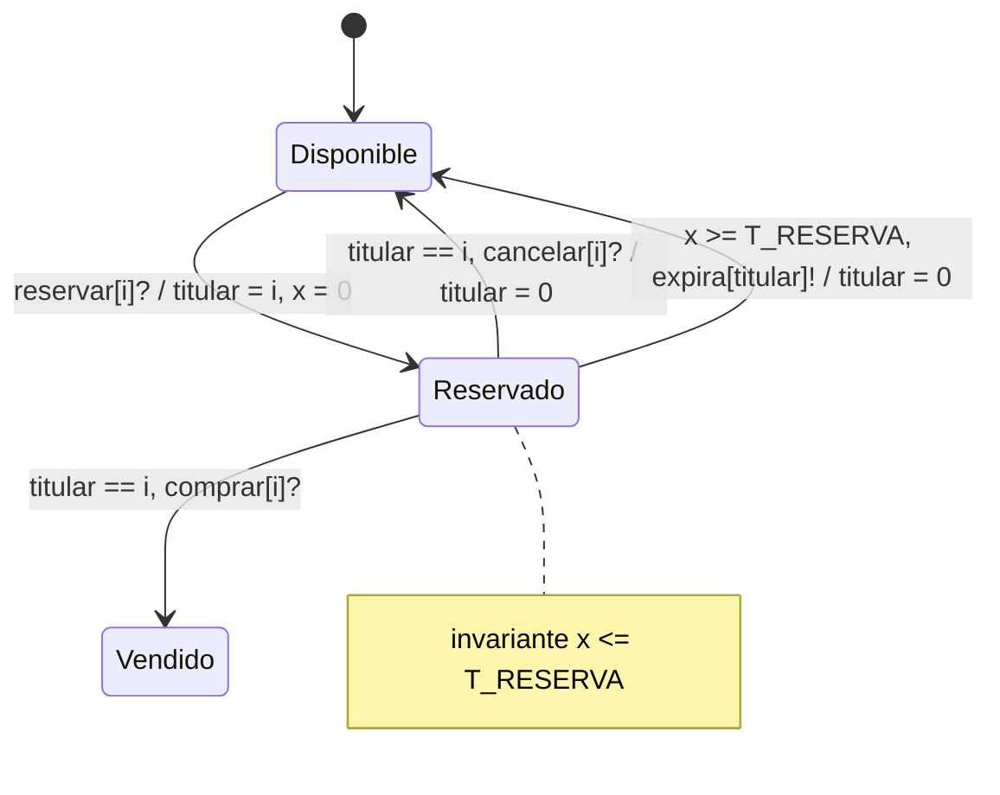

# Sistema de Venta y Reserva de Entradas para Eventos

Proyecto del curso de Aspectos Formales de Especificación y Verificación
(AFEV), Escuela Profesional de Ingeniería de Sistemas, UNSA. Tiene dos
partes:

- **Parte 1 (VDM++):** especificación formal del sistema de venta y
  reserva de entradas, validada con seis casos de prueba en el
  intérprete del Toolbox. El objetivo del modelo es que la sobreventa y
  la doble reserva de un asiento sean imposibles desde la
  especificación, no desde la implementación.
- **Parte 2 (UPPAAL):** verificación exhaustiva por model checking del
  ciclo de vida de un asiento, que comprueba para todas las
  intercalaciones posibles entre varios clientes lo que la Parte 1 solo
  comprobó para los escenarios de sus casos de prueba.

El estado de cada función se guarda en `map IdAsiento to Asiento`. Como un
mapeo es una funcion matematica, un identificador de asiento tiene un solo
registro y por lo tanto un solo estado. Sobre eso se agregan invariantes de
aforo, de coherencia de llave, de unicidad de entradas y de integridad
referencial, y precondiciones/postcondiciones en las operaciones que cambian
el estado de un asiento.

Regla de negocio para la compra: solo se puede comprar un asiento que este en
estado `<Reservado>` y cuyo titular sea el mismo cliente que lo reservo. No
existe venta directa de `<Disponible>` a `<Vendido>`. La misma regla aplica a
la cancelacion.

El modelo VDM++ es secuencial: no usa `thread` ni `sync`. El modelo UPPAAL de
la Parte 2 sí explora todas las intercalaciones posibles entre clientes, lo
que complementa esa limitación para el subsistema del ciclo de vida de un
asiento.

## Estructura

    modelo/Cliente.vdmpp           cliente del sistema
    modelo/Funcion.vdmpp           funcion del evento, tipos y mapa de asientos
    modelo/SistemaReservas.vdmpp   clase controladora y record Entrada
    pruebas/PruebasReserva.vdmpp   clase de pruebas (CP1 a CP6)
    pruebas/script_casos.txt       script para el interprete del Toolbox
    pruebas/correr_casos.bat       corre cada caso en una sesion aparte
    model-checking/asiento_reserva.xml            modelo UPPAAL
    model-checking/asiento_reserva_con_error.xml  variante con un error a proposito
    model-checking/propiedades.q                  consultas para verifyta

`Asiento` y `Entrada` son tipos record, no clases: `Asiento` esta declarado en
`Funcion` y `Entrada` en `SistemaReservas`.

## Cargar el modelo VDM++

### VDM++ Toolbox (vppde, verificado con la version 9.0.10)

Desde la carpeta raiz del proyecto, con `TB` apuntando a la instalacion del
Toolbox:

    vppde -p modelo\*.vdmpp pruebas\PruebasReserva.vdmpp "%TB%\stdlib\io.vpp" "%TB%\stdlib\VDMUtil.vpp"
    vppde -t modelo\*.vdmpp pruebas\PruebasReserva.vdmpp "%TB%\stdlib\io.vpp" "%TB%\stdlib\VDMUtil.vpp"

La primera linea hace el analisis sintactico y la segunda el de tipos. Las
librerias `io.vpp` y `VDMUtil.vpp` hay que pasarlas siempre, porque la clase
de pruebas usa `IO` para imprimir y `VDMUtil` para convertir numeros a texto.

### Overture

Crear un proyecto VDM++ y copiar las carpetas `modelo` y `pruebas` dentro.
Las librerias `IO` y `VDMUtil` se agregan desde el menu del proyecto
(Add VDM Library), no hay que copiar los archivos del Toolbox. En Overture las
operaciones de `IO` son estaticas, asi que en `PruebasReserva` se puede
reemplazar `io.echo(...)` por la llamada estatica a IO`echo si se prefiere.

En la configuracion de ejecucion hay que activar los chequeos dinamicos
(dynamic type check, invariants, pre-conditions, post-conditions) y usar como
expresion de arranque, por ejemplo:

    new PruebasReserva().CP1_ReservaYCompra()

Las pruebas se escribieron y ejecutaron con el Toolbox; en Overture no se
probaron porque no estaba instalado en la maquina de desarrollo.

## Correr las pruebas VDM++

Opcion 1, todos los casos en una sola sesion y con cobertura:

    vppde -o pruebas\script_casos.txt -q modelo\*.vdmpp pruebas\PruebasReserva.vdmpp "%TB%\stdlib\io.vpp" "%TB%\stdlib\VDMUtil.vpp"

El script activa `dtc`, `inv`, `pre` y `post` (sin eso el interprete no revisa
las precondiciones y los casos de fallo pasarian sin error), corre los seis
casos, escribe `pruebas/vdm.tc` y muestra la cobertura con `rtinfo`.

Opcion 2, un caso por sesion:

    pruebas\correr_casos.bat

Esta es la forma de obtener el mensaje de error de cada caso de fallo, porque
el Toolbox imprime el texto del error de ejecucion solo la primera vez en cada
sesion. En la opcion 1 los casos siguientes se detienen igual, y el comando
`backtrace` del script muestra en que operacion se detuvieron.

## Casos de prueba VDM++

- CP1 exito: Ana reserva el asiento 1 y lo compra. Estado final `<Vendido>`,
  una entrada emitida.
- CP2 fallo: comprar un asiento que nunca fue reservado. Falla la
  precondicion de `Funcion.ComprarEntrada`.
- CP3 fallo: Ana reserva el asiento 3 y Bruno intenta reservar el mismo.
  Falla la precondicion de `Funcion.ReservarAsiento`.
- CP4 fallo: agregar un cuarto asiento a una funcion con aforo 3. Falla la
  precondicion de `Funcion.AgregarAsiento`.
- CP5 exito: Ana reserva, cancela y Bruno reserva el mismo asiento.
- CP6 fallo: Bruno intenta comprar un asiento reservado por Ana. Falla la
  precondicion de `Funcion.ComprarEntrada`.

Cada caso imprime el valor esperado y el obtenido en texto plano. En los casos
de fallo se imprime el estado previo y el resultado esperado antes de la
llamada que viola la precondicion; si la linea final del caso llegara a
imprimirse, significaria que el modelo acepto algo que no deberia.

Resultado de la ultima ejecucion: todos los casos se comportaron como se
esperaba. La cobertura fue de 100% en `Cliente`, `Funcion` y
`SistemaReservas`, 96% en `PruebasReserva` (las ultimas lineas de los casos de
fallo no se ejecutan por diseno) y 95% de total, porque `rtinfo` tambien
cuenta las funciones de `IO` y `VDMUtil` que el modelo no usa.

El archivo `pruebas/vdm.tc` es generado por el interprete y se puede borrar.

## Parte 2: Model Checking con UPPAAL

La Parte 1 valida el modelo con seis casos de prueba concretos. La Parte 2
verifica, de forma exhaustiva, que un asiento nunca termine asignado a dos
clientes, considerando **todas** las formas en que varios clientes pueden
intercalar sus acciones. Usa UPPAAL sobre el ciclo de vida de un asiento
(`Disponible -> Reservado -> Vendido`, con retorno a `Disponible` por
cancelacion o por expiracion del tiempo de reserva).

### Comportamiento modelado

Cada cliente (`Cliente(id)`, con `id` de 1 a `N`) recorre
`Libre -> ConReserva -> ConEntrada` y regresa a `Libre` si cancela o si su
reserva expira.

### Declaraciones globales

| Elemento | Significado |
|---|---|
| `N = 3` | numero de clientes que compiten por el asiento |
| `T_RESERVA = 5` | tiempo maximo que puede durar una reserva |
| `titular` | cliente dueño de la reserva (0 = ninguno), equivale al campo `titular` del record VDM++ |
| `tenedores` | cuantos clientes creen tener el asiento; lo actualizan los clientes, y no se decrementa al vender porque el comprador sigue siendo el dueño |
| `pasoPorReservado` | bandera de observacion usada por P1 |
| `x` | reloj local del asiento, se reinicia al reservar |

### Propiedades verificadas

| Id | Consulta | Que garantiza |
|---|---|---|
| P1 | `A[] (Asiento.Vendido imply pasoPorReservado)` | no se vende sin reservar antes (propiedad estructural) |
| P2 | `A[] tenedores <= 1` | no hay doble reserva |
| P3 | `A[] (Asiento.Disponible imply titular == 0)` | un asiento libre no tiene dueño |
| P4 | `Asiento.Reservado --> (Asiento.Vendido or Asiento.Disponible)` | toda reserva termina (vivacidad) |
| P5 | `A[] (Asiento.Reservado imply Asiento.x <= T_RESERVA)` | una reserva no supera el tiempo limite (redundante con el invariante, se deja como control) |
| P6 | `A[] (deadlock imply Asiento.Vendido)` | el unico bloqueo es el asiento vendido |
| R1 | `E<> Asiento.Vendido` | la venta es alcanzable |
| R2 | `E<> (Asiento.Reservado and Asiento.x == T_RESERVA)` | la expiracion es alcanzable |
| R3 | `E<> Cliente(3).ConEntrada` | cualquier cliente puede comprar |

R1 a R3 son controles de cordura: una propiedad `A[]` se cumple trivialmente
en un modelo que no hace nada.

### Como ejecutarlo

Requiere UPPAAL 4.1 o superior (licencia academica gratuita en
<https://uppaal.org>).

**Interfaz grafica**

1. `File > Open System` y abrir `model-checking/asiento_reserva.xml`.
2. Pestaña **Simulator** para recorrer el modelo paso a paso.
3. Pestaña **Verifier**: las consultas ya vienen cargadas en el archivo.
   Seleccionarlas y presionar **Check**.

**Linea de comandos**

    verifyta model-checking/asiento_reserva.xml model-checking/propiedades.q

Resultado esperado: todas las consultas satisfechas en `asiento_reserva.xml`.
En `asiento_reserva_con_error.xml`, P2 no se cumple y el verificador devuelve
una traza con dos clientes en `ConReserva` a la vez:

    verifyta -t0 model-checking/asiento_reserva_con_error.xml model-checking/propiedades.q

### Decisiones de modelado

- **Se incluyo el tiempo de expiracion.** Sin el reloj, un cliente podria
  retener la reserva indefinidamente y P4 seria falsa; con el reloj, el
  invariante `x <= T_RESERVA` obliga a salir de `Reservado`.
- **Se verifica un solo asiento.** El problema de exclusion es local a cada
  asiento, y agregar varios asientos con aforo multiplica el espacio de
  estados sin aportar una propiedad nueva sobre la doble reserva.
- **Las transiciones son atomicas,** igual que las operaciones del modelo
  VDM++. La diferencia es que aqui el verificador explora todas las
  intercalaciones entre los clientes.

### Relacion con el modelo VDM++

| VDM++ (Parte 1) | UPPAAL (Parte 2) |
|---|---|
| `EstadoAsiento = <Disponible> \| <Reservado> \| <Vendido>` | ubicaciones de la plantilla `Asiento` |
| campo `titular : [IdCliente]` | variable `titular` (0 en lugar de `nil`) |
| `pre asientos(id).estado = <Disponible>` en `ReservarAsiento` | `reservar` solo sale de `Disponible` |
| `pre ... titular = c` en `ComprarEntrada` | guarda `titular == i` |
| no modelado | expiracion con reloj `x` |

## Autores

- Choquehuanca Zapana, Hernan Andy
- Portugal Portugal, Eduardo Sebastian Stephan
- Quispe Huaman, Rodrigo Ferdinand
- Salas Aguilar, Juan Victor

Asesora: Mg. Maribel Molina Barriga