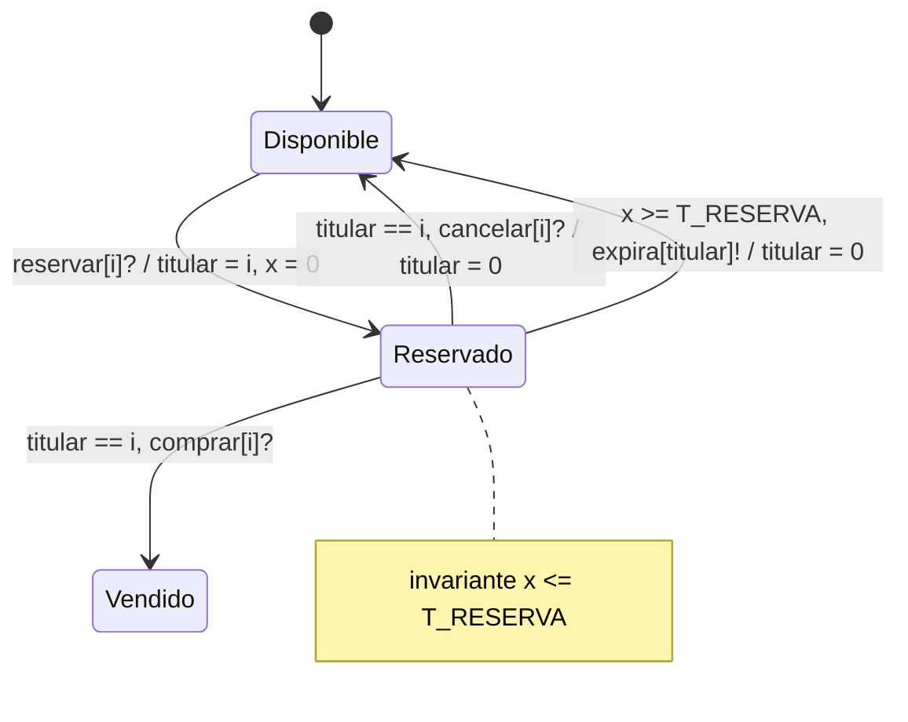

# Model Checking del ciclo de vida de un asiento (UPPAAL)

Parte 2 del proyecto **Sistema de Venta y Reserva de Entradas para Eventos** del curso Aspectos Formales de Especificación y Verificación (Escuela Profesional de Ingeniería de Sistemas, UNSA).

La Parte 1 especificó el sistema en VDM++ y lo validó con casos de prueba en el intérprete. Este módulo verifica, de forma exhaustiva, que un asiento nunca termine asignado a dos clientes, considerando todas las formas en que varios clientes pueden intercalar sus acciones.

## Contenido

```
model-checking/
├── README.md
├── modelo/
│   ├── asiento_reserva.xml            modelo UPPAAL (plantillas Asiento y Cliente)
│   ├── asiento_reserva_con_error.xml  variante con un error introducido a propósito
│   └── propiedades.q                  consultas para verifyta
└── articulo/
    └── seccion_model_checking.tex     sección para el artículo IEEE
```

## Comportamiento modelado



Cada cliente (`Cliente(id)`, con `id` de 1 a `N`) recorre `Libre -> ConReserva -> ConEntrada` y regresa a `Libre` si cancela o si su reserva expira.

### Declaraciones globales

| Elemento | Significado |
|---|---|
| `N = 3` | número de clientes que compiten por el asiento |
| `T_RESERVA = 5` | tiempo máximo que puede durar una reserva |
| `titular` | cliente dueño de la reserva (0 = ninguno), equivale al campo `titular` del record VDM++ |
| `tenedores` | cuántos clientes creen tener el asiento; lo actualizan los clientes |
| `pasoPorReservado` | bandera de observación usada por P1 |
| `x` | reloj local del asiento, se reinicia al reservar |

## Propiedades

| Id | Consulta | Qué garantiza |
|---|---|---|
| P1 | `A[] (Asiento.Vendido imply pasoPorReservado)` | no se vende sin reservar antes |
| P2 | `A[] tenedores <= 1` | no hay doble reserva |
| P3 | `A[] (Asiento.Disponible imply titular == 0)` | un asiento libre no tiene dueño |
| P4 | `Asiento.Reservado --> (Asiento.Vendido or Asiento.Disponible)` | toda reserva termina (vivacidad) |
| P5 | `A[] (Asiento.Reservado imply Asiento.x <= T_RESERVA)` | una reserva no supera el tiempo límite |
| P6 | `A[] (deadlock imply Asiento.Vendido)` | el único bloqueo es el asiento vendido |
| R1 | `E<> Asiento.Vendido` | la venta es alcanzable |
| R2 | `E<> (Asiento.Reservado and Asiento.x == T_RESERVA)` | la expiración es alcanzable |
| R3 | `E<> Cliente(3).ConEntrada` | cualquier cliente puede comprar |

R1 a R3 son controles de cordura: una propiedad `A[]` se cumple trivialmente en un modelo que no hace nada.

## Cómo ejecutarlo

Requiere UPPAAL 4.1 o superior (licencia académica gratuita en <https://uppaal.org>).

**Interfaz gráfica**

1. `File > Open System` y abrir `modelo/asiento_reserva.xml`.
2. Pestaña **Simulator** para recorrer el modelo paso a paso.
3. Pestaña **Verifier**: las consultas ya vienen cargadas en el archivo. Seleccionarlas y presionar **Check**.

**Línea de comandos**

```bash
verifyta modelo/asiento_reserva.xml modelo/propiedades.q
```

**Resultado esperado:** todas las consultas satisfechas en `asiento_reserva.xml`. En `asiento_reserva_con_error.xml`, P2 no se cumple y el verificador devuelve una traza con dos clientes en `ConReserva` a la vez.

```bash
verifyta -t0 modelo/asiento_reserva_con_error.xml modelo/propiedades.q
```

## Decisiones de modelado

- **Se incluyó el tiempo de expiración.** Sin el reloj, un cliente podría retener la reserva indefinidamente y P4 sería falsa; con el reloj, el invariante `x <= T_RESERVA` obliga a salir de `Reservado`.
- **Se verifica un solo asiento.** El problema de exclusión es local a cada asiento, y agregar varios asientos con aforo multiplica el espacio de estados sin aportar una propiedad nueva sobre la doble reserva.
- **Las transiciones son atómicas,** igual que las operaciones del modelo VDM++. La diferencia es que aquí el verificador explora todas las intercalaciones entre los clientes.

## Relación con el modelo VDM++

| VDM++ (Parte 1) | UPPAAL (Parte 2) |
|---|---|
| `EstadoAsiento = <Disponible> \| <Reservado> \| <Vendido>` | ubicaciones de la plantilla `Asiento` |
| campo `titular : [IdCliente]` | variable `titular` (0 en lugar de `nil`) |
| `pre asientos(id).estado = <Disponible>` en `ReservarAsiento` | `reservar` solo sale de `Disponible` |
| `pre ... titular = c` en `ComprarEntrada` | guarda `titular == i` |
| no modelado | expiración con reloj `x` |

## Autores

- Choquehuanca Zapana, Hernan Andy
- Portugal Portugal, Eduardo Sebastian Stephan
- Quispe Huaman, Rodrigo Ferdinand
- Salas Aguilar, Juan Victor

Asesora: Mg. Maribel Molina Barriga
